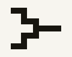
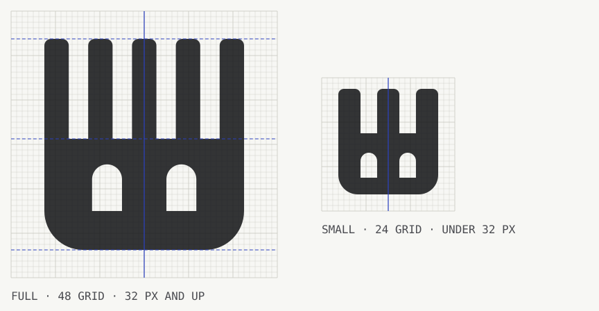

# Weir design brief: "The clearing sheet", v2

This brief describes the site as it is. Change it before building something it does not allow. Every figure on the site comes from the contract views (SPEC section 12), `evidence/`, `backtest/` results or the engine running on the server or in the browser. No page types a number; worked examples are computed by the engine and labelled as examples.

## 1. Positioning

**Promise:** buyers and sellers of H100 time agree next week's price in one sealed auction, and every position is paid in full when it opens.

**First five seconds, in this order:**
1. The promise, set large: "One price for next week's GPU-hour".
2. The live H100 index and what it is the median of.
3. The mechanism, moving: sealed bids arrive, open, the two staircases cross, one price is set, the filled orders light up (the hero film, section 7.3).

**With no wallet, the home page lets a visitor:** read the live index and each source; watch one round clear; see the current series, its band and the phase clock; drag a fixing across the payoff diagram; size a hedge at the last clearing price; open the last clearing; start the simulation.

**Audience.** Investors and protocol founders judging a hackathon. Four sites with the same theme won elsewhere with dark trading terminals or particle-field landing pages. Weir is the opposite on purpose: warm paper, ink, two side colours, and one drawing that explains the product by moving.

## 2. Name

**Weir**: a low dam that holds a river's level steady. The product holds your compute price level. No crypto, DeFi or compute product named Weir was found; collisions outside the category are WEIR AI (weir.ai) and The Weir Group. Pair the name with a product word ("Weir auction") in search. Alternates if a clash appears: Clearhour, Batchrate.

**Tagline:** "One price for next week's GPU-hour."

## 3. Logo

### 3.1 Three concepts

| | Concept | Verdict |
|---|---|---|
|  | **A. Crest W.** A W whose top ends and centre are cut flat on one line, the crest of a weir. | Rejected. At every size it reads as a slab-serif capital W: the short flats look like serifs, not like water. Nothing about it is ownable. |
|  | **B. Two staircases.** Demand steps down, supply steps up, they meet at one point and a single price line runs on to the right. | Rejected, narrowly. It is the mechanism exactly, but at 16 px the steps merge into a bracket and the whole reads as a circuit or tree glyph. It survives as the hero film, where it has room. |
|  | **C. Level seal.** A ring (the sealed bid) cut by a level line with one step in it. | Rejected. A ring with a bar through it is the grammar of "no entry" and power symbols; the seal idea is clearer in the product (the lock glyph) than in a badge. |
|  | **Chosen: the held level.** One stroke: a level line runs flat, drops into a W, and comes back to exactly the same level. | It is a weir in profile (the level is the same on both banks, the drop is held between them) and the W of the name. The long banks are what make it ours: a W alone is a letter, a W hung from a level line is a mark. |

### 3.2 Construction

- **Wide master** (`lib/logo.ts`, `MARK.wide`): 32 x 24 grid. Path `M1 6 H8.5 L12.25 18.5 L16 6 L19.75 18.5 L23.5 6 H31`, stroke 2.5 units, butt caps. The level is y = 6; the points sit at y = 18.5; the axis of symmetry is x = 16. Banks are 7.5 units, each diagonal rises 12.5 over 3.75.
- **Compact master** (`MARK.compact`): 24 x 24 grid, stroke 3, `M1 7 H6.5 L9.25 18 L12 7 L14.75 18 L17.5 7 H23`. A narrower W so the banks stay long when the whole mark is a 16 px favicon. Used under 24 px and in every app icon.
- **Optical corrections.** Joins use `miterlimit 2`: the four shoulders (107 degrees, ratio 1.24) keep their sharp miters, while the three acute points (ratio above 3) are cut flat. The cut stops the points from reading heavier and longer than the level line, and it makes the centre point a small flat crest that sits on the level. The points reach 0.4 units below y = 18.5 after the cut; that overshoot is intended, as in a typeface's W.
- **Wordmark.** Set, not drawn: Archivo at width 125, weight 800, tracking -0.02 em. The lockup uses the mark cropped to its strokes (`viewBox 0 4.75 32 14.25`) at exactly cap height (0.715 em), aligned to the baseline, so the level line is the cap line of "Weir". Gap between mark and word: 0.28 em.
- **Colour.** One colour only, always `currentColor`: ink on paper, paper on ink. No gradient, no second colour, never orange or teal (those mean LONG and SHORT).

### 3.3 Usage rules

- **Clear space:** the height of the W (12.5 units, about half the mark's height) on every side of the lockup.
- **Minimum size:** wide mark 24 px wide; compact mark 16 px; lockup 72 px wide.
- **Do:** use the lockup in the header and footer; use the compact mark on a tile for icons; let a long level line run into the mark's banks as a rule (the footer does).
- **Do not:** recolour it in a side colour, outline it, add a shadow, round its joins, stretch it, set the wordmark in another face or width, or put the mark inside a circle.

### 3.4 Files

`components/logo.tsx` (`Mark`, `Lockup`), `lib/logo.ts` (geometry), `brand/*.svg` (concepts, masters, construction). `tools/og-image.ts` renders from the same geometry: `public/icon.svg` (compact mark on a 7-unit-radius ink tile, swapping to a paper tile for dark tab bars), `public/icon-32.png`, `public/apple-icon.png` (180), `public/icon-512.png` (full-bleed squares; launchers round them), and `public/opengraph-image.png` (1200 x 630: lockup, promise, and the hero film's last frame with its price line running off the edge).

## 4. Colour and type

**What changed from v1, and why.** The palette and the two typefaces stay: the warm paper and two side colours are already unlike every competitor, and changing them would only cost recognition. What changes is hierarchy and surface. The hero headline is larger (up to 72 px) and tighter (-0.03 em) so the promise lands first; a slightly lighter `--sheet` surface sets off the things you are meant to look at (the film, the how drawings, code) from the paper they sit on; and the eyebrows carry a 20 px ink rule, the mark's level line, as the one recurring brand device.

| Token | Light | Dark | Use |
|---|---|---|---|
| `--paper` | `#F7F5EF` | `#13120E` | Ground |
| `--sheet` | `#FBFAF6` | `#191813` | Figures to look at: hero film, /how drawings, code |
| `--panel` | `#EDEAE1` | `#1D1B16` | Bands, footer, hover rows |
| `--rule` | `#D6D0C2` | `#37332A` | Lines only |
| `--ink` | `#17150F` 16.7:1 | `#EEEAE0` 15.6:1 | Text, the clearing line, the index |
| `--ink-2` | `#5A5446` 6.9:1 | `#ABA494` 7.6:1 | Secondary text |
| `--ink-3` | `#7A7466` | `#857F70` | Source lines, gridlines; never text under 21 px |
| `--long` | `#B23F0C` 5.3:1 | `#F2894A` 7.5:1 | LONG, buyers, demand. Also the "now" rule and the clock's beat |
| `--short` | `#0A6670` 6.1:1 | `#52BEC4` 8.5:1 | SHORT, sellers, supply; a passed check |
| `--flag` | `#875A00` 5.5:1 | `#E2B04C` 9.4:1 | Stale, unverified, part-filled, model ribbon |
| `--bad` | `#A3202E` 6.9:1 | `#F27D86` 7.2:1 | Errors, failed checks |

Soft tints (`--long-soft`, `--short-soft`) are 18% of the side colour over paper. No red/green pair, no purple, no gradients.

**Type.** Archivo (OFL, width 62 to 125, weight 100 to 900): 125/800 for the wordmark, 112/750 to 800 for headings and display figures, 100/400 for text, 85 for dense tables. IBM Plex Mono (OFL) for hashes, accounts, the commit string and code. Both self-hosted in `app/fonts` with their licences. Sizes: 13, 15, 17, 21, 32, display clamp(40, 5vw, 72), hero clamp(42, 5.4vw, 72). Tabular figures everywhere. No italic.

**Space.** 4, 8, 12, 16, 24, 32, 48, 64, 96 px. Gutter 16 px at 375, 4vw, 56 max. Radius 4 px; 2 px on tickets and cards that stand for orders.

**Numbers.** A unit on every figure: "$2.31 /GPU-h", "1,344 GPU-h", "$41,200 locked". Dollars to the `tick`. Times in UTC with the zone written. Missing is "no data", never 0; a real zero amount reads "none"; a chart origin reads "0".

## 5. Site map

| Path | Purpose |
|---|---|
| `/` | Hero (promise, live index, the clearing film), series and phase clock, index chart, the index and its sources, last clearing, payoff and hedge sizer, three facts, limits |
| `/auction` | The round in progress: sealed book, phase clock, curves as reveals land, the last cleared round, recent rounds. `?series=&round=` for any past round |
| `/simulate` | A market of scripted agents cleared by the real engine in a Web Worker |
| `/backtest` | Hedged against unhedged cost over real H100 history, and band coverage |
| `/how` | Five explanatory sequences (series clock, commit and reveal, clearing, settlement, funding), then limits and trust |
| `/proof` | Contracts, parameters, transactions, bundle hashes re-verified in the browser, live solvency |
| `/agents` | A key that can bid and cannot withdraw; the commands, the commit string, a minimal loop; agents on the book |

Header: lockup, the seven links, a "Testnet" tag with a teal dot (hidden under 420 px, where the hero eyebrow and the footer say it), the Weekly / Fast switch, the theme button. The model ribbon sits above it in model mode. Footer on `--panel`: a level rule that runs into the mark, the lockup and tagline, three link columns (Market, Read, For agents), and a colophon line (build time, SPEC version, no analytics, typefaces).

## 6. Page by page

### `/`
1. **Hero.** Left: eyebrow "Sealed auctions for H100 time · NEAR testnet", h1 "One price for next week's GPU-hour", one sentence, then under a 2 px ink rule the live index figure (last final print, its age, how many reports it is the median of, a link to the sources) and two actions: "The round in progress" and "How it works". Right, on a sheet: the clearing film (7.3). Under 1000 px the film goes under the copy. The h1 and the figure are server HTML, so the film never delays the largest paint.
2. **Series and phase clock.** One strip per live series (auction rounds, cutoff, delivery, settlement, a "now" rule), then floor, band, open sets and the phase countdown with its beat.
3. **Index chart**, 24 h / 7 d / 30 d (1 h / 6 h / 24 h on Fast), with the delivering series' band and running average.
4. **The index and its sources.** The sources of the latest bundle (or the recorded sample, labelled) beside the reports behind the print.
5. **Last clearing.** Compact step chart and three figures.
6. **Payoff and hedge size**, **three facts**, **limits**.

### `/how`
Page head, then five sections. Each is a paragraph on the left and a sequence on the right (on a sheet, with Back, Play and Next and a "2/5" step count). Below the sequences: the dates of the series drawn, the commit fields and lock rule, the settlement table. Then limits and trust in full.

### `/auction`, `/simulate`, `/backtest`, `/proof`, `/agents`
As v1 (section 12), with the shared polish: page heads with the level-rule eyebrow, tables with a hover row, live figures that settle when they change, the sealed book's rows landing with an ink edge, the bundle verifier resolving check by check. `/agents` code blocks have an ink title bar (`Shell · near-cli-rs · testnet`, `agent.mjs · Node 22`), comment lines in `--ink-2` and a copy button that confirms with a check.

### States
Loading: grey bars, never `$0.00`. Error: left rule in `--bad`, "The NEAR RPC did not answer", the last good read time, "Read again". Stale: `--flag`. **Empty and not deployed** are designed states: a dashed outline, a small level-line glyph with a gap in it, the sentence, and for "not deployed" a line pointing to the simulation and the backtest, which run without a chain.

### 404
"No page at this address", the line "The level runs out here", a drawing of the mark's level line that drops off into a dashed lower level with "404" on it (it draws itself once), and every page of the site as a list of large links.

## 7. Motion

### 7.1 Principle
Motion explains or confirms; it never decorates. Every motion below has a purpose that fits in a few words. Nothing loops, nothing moves on scroll, and nothing counts up on load. Under `prefers-reduced-motion: reduce` every CSS animation and transition is off, figures show their last frame with a caption, and the /how sequences can still be stepped by hand (each step is an instant change).

### 7.2 Tokens
In `app/globals.css` as custom properties and in `lib/motion.ts` for scripts; the two lists are the same.

| Token | Value | For |
|---|---|---|
| `--dur-micro` | 120 ms | Hover, press, focus: the interface answering a hand |
| `--dur-quick` | 200 ms | Toggles, tabs, a row changing state, nav underline |
| `--dur-base` | 320 ms | Something arriving or being revealed |
| `--dur-settle` | 560 ms | A value that changed under you |
| `--dur-draw` | 900 ms | A line drawing itself |
| `--ease-out` | cubic-bezier(0.22, 0.61, 0.36, 1) | Arrivals and reveals |
| `--ease-in-out` | cubic-bezier(0.65, 0, 0.35, 1) | Lines and sweeps that travel |
| linear | | Progress bars and clocks |

### 7.3 The hero film
`lib/film.ts` builds one example round of eight orders (four LONG, four SHORT, interleaved), hashes each with the engine's `commitHash` and clears it with `clearRound` (`engine/src/mod.ts`). The example is chosen so that every outcome appears: four filled, one filled in part (G, 5 of 25), three out. The film is a score (`Score` in `lib/motion.ts`): tracks keyed by `data-track` names, played with the Web Animations API by `components/motion-figure.tsx`. In 8.8 seconds:

| Beat | At | What moves |
|---|---|---|
| Sealed bids arrive | 0 ms | Eight tickets drop in, 170 ms apart; each shows only a lock and the start of its hash |
| Reveal | 1.7 s | Each hash cross-fades into side, size and LONG price |
| Curves | 3.2 s | Demand draws down from the highest bid, supply up from the lowest ask |
| Cross | 4.8 s | A ring pops where they meet |
| Sweep | 5.3 s | One ink price line sweeps across; the price appears beside it |
| Fill | 6.3 s | Filled steps thicken, the two paid areas tint, tickets read "filled 30", "part, 5 of 25" or "out" (out tickets dim) |
| Hold | 7.5 s | "SHORT pays $0.50 / LONG pays $0.40" settle in; the caption says each pair is backed in full |

Controls: Play / Pause / Replay (one button, labelled with its action) and a Replay-from-start button, both 44 px, keyboard-operable. A 2 px progress line runs under the stage. The caption under the controls narrates the current beat. The stage's space is fixed (chart height by breakpoint, tickets at fixed height) so nothing shifts. The server renders the last frame; elements that enter are hidden only while the score binds (with a 2.5 s CSS failsafe), and the h1 and index figure are plain HTML, so the film cannot hold back the largest paint. Under reduced motion it shows the last frame and the summary sentence, and no play controls. Text alternative: the stage is `role="img"` with the summary as its label.

### 7.4 The /how sequences
`lib/how-scores.ts`, five scores of four or five 1.5 s steps, each played or stepped by hand; Back and Next move whole steps (a step's parts all finish inside it; a unit test holds that). They autoplay once when a third of the figure is in view.
1. **Series clock**: the auction window opens; one round fills, commit then reveal; the other rounds and the cutoff; delivery with its prints; the grace period and settlement. Labels carry the live `get_params` durations. Not to scale, and says so.
2. **Commit and reveal**: the order; the preimage with its salt highlighted and its sha256; what the chain holds (hash, lock, three locked columns); the reveal; the check "same hash" and the order in the round.
3. **Clearing**: the three order chips; demand draws; supply draws; the cross and the price; fills and paid areas, each step labelled "A filled 10", "B 5 of 10".
4. **Settlement**: the band; seven example prints arrive; their running average draws and the fixing is marked (the fixing is computed as their average, and the table under it uses the same number); the LONG share of the band grows; the SHORT share completes the band.
5. **Funding**: USDC on four chains; NEAR Intents (dashed, in `--flag`, while no transfer is on record); USDC on NEAR; `ft_transfer_call` into Weir.

### 7.5 Everywhere else

| Motion | Where | Purpose |
|---|---|---|
| Lines draw in once (900 ms) when a chart first enters view; clearing lines and labels fade in after | Every `ChartFrame` chart: index, step, payoff, backtest | Shows how the line is built; never on charts already on screen at load |
| A revealed row lands: panel tint fades and a 3 px ink edge fades (560 ms, 1.6 s) | Sealed book on `/auction` and `/simulate` | Points at what just changed |
| The clock beats: an orange dot shrinks and fades once a second | Every phase countdown | Says the clock is live |
| Checks resolve one after another: "checking" then the result, 140 ms apart | Bundle verifier on `/proof` | The checks are real work done in this browser |
| A live figure settles: rises 0.18 em and fades a `--flag-soft` tint (1.1 s), only when its value changes after a refresh | Hero index, last clearing figures, auction commits and total locked | A moved number is noticed; an unchanged one is left alone |
| Nav underline grows from the left (200 ms); current page fully underlined | Header | Where you are, where you are going |
| Buttons, switches, tabs, rows: colour in 120 ms; buttons press 1 px | Everywhere | The interface answers |
| Theme: one 320 ms cross-fade via the View Transitions API, with every transition off during the swap; instant where unsupported or reduced | Theme button | No element fades through the wrong colour |
| Mark compresses slightly on hover (560 ms) | Header lockup | A quiet sign that it is a link home |
| The 404 level line draws and drops | 404 | The page's one joke, told once |

## 8. Charts

As v1. **Auction step chart:** x cumulative GPU-hours, y LONG price 0 to `band` with forward ticks on the right; demand a falling staircase in `--long`, supply a rising one in `--short`; the clearing a 2 px ink horizontal with "Clears at $0.62 · forward $2.31" and a dashed vertical at the volume; filled steps 3 px, unfilled 1 px at 50%; part fills ticked; the paid areas tinted. **Index chart:** reporters as thin `--ink-3` lines, the index a 2 px ink step line with gaps, the delivering series' band and running average. **Payoff diagram:** draggable fixing (arrows one tick, shift ten). **Backtest chart:** band per week, unhedged dots, hedged ticks, `--flag` marks for weeks outside the band.

## 9. Copy rules

Voice: a clerk reading the results: the figure, then its source. Headings are names without a full stop. No "X, not Y" turns, em dashes or emoji. Banned: revolutionary, seamless, unlock, empower, trustless, guaranteed, risk-free, insurance, yield, bet, AI-powered, next-gen. "Testnet" in the header and on `/proof`. A modelled or simulated figure says so in the same line; a figure not verifiable on chain carries "unverified" in `--flag`. Animated captions follow the same rules and carry the engine's figures.

## 10. What to steal and what to avoid

| Site | Steal | Avoid |
|---|---|---|
| PIRY | The browser-verified checklist for the bundle verifier; the source table with quorum | Dark serif hero with an italic accent |
| Agate | Source bars with the middle value marked; the agent budget card | "$0.00" tiles while loading |
| Rackrate | "Know the outcome before the week starts" slider | Purple-on-black hero, "Connect wallet" in the header |
| Corpus | Versioned methodology, known limitations | Particle-field hero |
| Levee | Failures kept on the record; Can / Can't boards | Its metro lanes and white ground |

## 11. Build notes

Next.js App Router, React, TypeScript, no component library and no animation library: motion is CSS plus the Web Animations API. The motion code added for v2 (`motion-figure.tsx`, `clearing-film.tsx`, `how-figures.tsx`, `live-value.tsx`, `lib/motion.ts`, `lib/how-scores.ts`) is about 10 kB gzipped before minification. Charts are hand-written SVG drawn on the server at 375 and 1200 px and redrawn at real width. Views read through `lib/near.ts`. The film and the /how scores are built on the server and passed as plain data. No external requests beyond the RPC endpoints and the bundle host.

Components added in v2: `Lockup`, `Mark` (logo); `MotionFigure` (plays a score, controls, reduced-motion fallback); `ClearingFilm`, `ClearingChart` (hero and /how clearing); `SeriesClockFigure`, `CommitFigure`, `ClearingFigure`, `SettlementFigure`, `FundingFigure`; `LiveValue`; `HeroIndex`, `IndexSources` (the old `IndexHead` split in two).

## 12. Changes made while building (v1), still in force

- **No order form, no wallet.** `/auction` shows the sealed book, the phase clock, the curves as reveals land, the last cleared round and recent rounds, and a "Bid with an agent" panel linking to `/agents`.
- **Two markets.** Weekly / Fast in the header, `?m=fast` in the URL; light / dark / system theme button.
- **Series strip** shows auction rounds, the cutoff, delivery and settlement, with no trading inside delivery; home draws the series in delivery as well.
- **Index chart lines are reporters, not sources**; sources are in the table under the hero.
- **Fills table has no "refunded" column**: `get_result` does not carry locks.
- **Exact zero dollar amounts read "none".**
- **Phone fills table**: hidden columns appear as a second line under the owner.
- **Bundle verifier without a bundle host** re-hashes the recorded sample in `evidence/bundles/`, labelled.
- **Model mode** (`WEIR_MODEL=1`): every view from the engine running a fixed script; every page carries the ribbon "Model data, not the chain".

## 13. Changes in v2

- New logo system (section 3), favicons, app icons and Open Graph image from one geometry.
- Home opens with a composed hero and the clearing film; the sources table moved from the opening into its own section.
- A motion system (section 7) replaces v1's rule that almost nothing moves.
- `/how` drawings became stepable sequences; the settlement fixing is now the computed average of the example prints.
- Designed empty, not-deployed and 404 states; code blocks with title bars; footer rebuilt.
